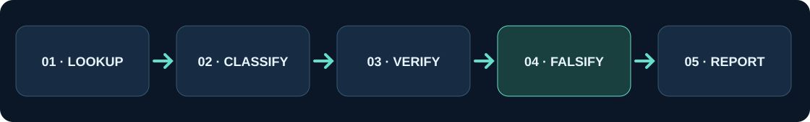

<div align="center">
  

  # Pattern Atlas

  **Describe. Verify. Falsify.**

  A portable, offline-first Agent Skill for chart-pattern research, identification and critical validation.

  [](https://agentskills.io/specification)
  [](https://www.skills.sh/kaigorodovtuskul/pattern-atlas-technical-analysis-agent-skill/pattern-atlas)
  [](LICENSE)
  [](#installation)
  [](https://www.thepatternsite.com/chartpatterns.html)

  **English** · [Русский](README.ru.md) · [Offline gallery](gallery.html) · [Source audit](docs/SOURCE_AUDIT.md)
</div>

---

## About

**Pattern Atlas** is an open-source Agent Skill with a technical-analysis pattern catalog, original educational SVG schematics and auditable tools for OHLCV data. The catalog follows the names in [Thomas Bulkowski's alphabetical index at ThePatternSite](https://www.thepatternsite.com/chartpatterns.html) and is written independently: **it is not a mirror of the site, a verbatim reproduction of its descriptions, or a source of its statistics**.

The idea is that an AI agent should not merely recognize a visually similar shape; it should explain why a formation can be **falsified**. The agent must distinguish a catalog lookup from a confirmed signal on a chart and from a proven statistical regularity.

<p align="center"></p>

### What is included

| Component | Volume | Status |
|---|---:|---|
| Unique catalog entries | **383** | Index-name transcription; 426 source rows, 43 exact duplicates |
| Methodological families | **38** | Original Russian criteria and analytical caveats |
| Individual pages | **383** | One per entry, with features, limitations and a source link |
| Original SVG schematics | **334** | Programmatically generated educational **family** examples, not real trading charts |
| Direct URLs found | **35** | Page links checked; **not** all claims on those pages |
| OHLCV scanner | **limited** | Inside/outside, NR4/NR7, full gaps, confirmed double top/bottom heuristic |
| Offline gallery | **1 HTML file** | Search and filters, no server, CDN or bundler |

> **Accuracy rule.** 383 is coverage of *index entries*, not 383 scientifically validated trading strategies or 383 implemented recognition algorithms. Some entries are methods, studies and events rather than chart formations. Many author-specific definitions require page-level verification; the code marks this explicitly. See [SOURCE_AUDIT](docs/SOURCE_AUDIT.md).

## Quick look

Open [`gallery.html`](gallery.html) in a browser after cloning the repository. The gallery provides search, family and category filters, SVG previews and links to individual Markdown entries and the original source. For reliable image rendering, open the local copy rather than the GitHub HTML preview.

Example materials:

- [Ascending triangles](skills/pattern-atlas/patterns/ascending-triangles.md) — shape, confirmation, false signals, SVG
- [Head-and-shoulders tops](skills/pattern-atlas/patterns/head-and-shoulders-tops.md) — neckline/shoulders and invalidation rules
- [Double bottoms](skills/pattern-atlas/patterns/adam-and-adam-double-bottoms.md) — candidate vs neckline breakout
- [Source audit](docs/SOURCE_AUDIT.md) — what is and is NOT verified

## Installation

### Agent installer

```bash
npx skills add KaigorodovTuskul/Pattern-Atlas-Technical-Analysis-Agent-Skill --skill pattern-atlas
```

For Codex / Claude Code / Cursor, select specific agents in the [skills CLI](https://github.com/vercel-labs/skills). The command installs the skill directly from this repository.

### Offline installation without third-party dependencies

```bash
# From the repository root; Python 3.9+
python scripts/install.py --project /path/to/project --agent codex --dry-run
python scripts/install.py --project /path/to/project --agent codex
```

Supported values: `codex`, `claude-code`, `cursor`, `opencode`, `gemini`, `copilot`, `generic` — exact paths are documented in [COMPATIBILITY](docs/COMPATIBILITY.md). The installer will not overwrite an existing skill without `--force`. You can also copy `skills/pattern-atlas` manually into a supported folder.

## Usage

```text
Use Pattern Atlas to analyze the attached daily chart.
Identify 2–3 formation hypotheses, mark boundaries, the confirmation level
and the invalidation criterion. Do not invent prices, probabilities or Bulkowski statistics.
```

```bash
# Search an original term or a Russian methodological description
python skills/pattern-atlas/scripts/search_catalog.py "cup with handle"
python skills/pattern-atlas/scripts/search_catalog.py "клин" --json
python skills/pattern-atlas/scripts/search_catalog.py --families
python skills/pattern-atlas/scripts/search_catalog.py --stats

# Open a detailed entry by slug
python skills/pattern-atlas/scripts/search_catalog.py --id ascending-triangles

# Limited reproducible OHLCV screener
python skills/pattern-atlas/scripts/scan_ohlcv.py examples/demo_ohlcv.csv --output results.json
```

CSV format: `date,open,high,low,close[,volume]`. Dates must be sorted in an ISO-compatible format; volume is optional. The screener does not download data, does not adjust for corporate actions and **cannot automatically detect every pattern in the catalog**. Criteria and coverage are documented in [DETECTION](skills/pattern-atlas/references/DETECTION.md).

## Repository structure

```text
Pattern-Atlas-Technical-Analysis-Agent-Skill/
├── README.md / README.ru.md / AGENTS.md / LICENSE / NOTICE / CHANGELOG.md
├── gallery.html                 # interactive standalone catalog
├── skills/pattern-atlas/
│   ├── SKILL.md                # agent instructions, progressive disclosure
│   ├── data/
│   │   ├── catalog.json        # 383 records: URLs/confidence/descriptions/schematics
│   │   ├── families.json       # 38 families
│   │   └── index_names.txt     # index transcription preserving duplicates
│   ├── patterns/               # 383 individual descriptions
│   ├── references/             # 38 methodologies + indexes + protocols
│   ├── assets/                 # 334 original SVGs + demo OHLCV
│   └── scripts/                # search, OHLCV scanner
├── scripts/                    # build, render, install, validate
├── docs/                       # source notes, methodology, compatibility
├── examples/                   # demo data, prompts
├── tests/                      # unit/integration + behavioral scenarios
└── .github/workflows/ci.yml   # CI checks
```

## Validation / reproducibility

```bash
python scripts/validate.py
python -m unittest discover -s tests -v

# Rebuild the catalog, educational SVGs, pages and gallery locally
python scripts/build_catalog.py
python scripts/render_diagrams.py
python scripts/build_docs.py
python scripts/validate.py
```

The checks verify file integrity, link consistency, SVG syntax, data schema and basic scanner properties. **They do not establish the original accuracy of pattern statistics, outperformance versus buy-and-hold, or exact correspondence with every author page.**

## Scope and limitations

Pattern Atlas is a portable, dependency-free Agent Skill inspired by the **index/taxonomy** of Thomas Bulkowski's ThePatternSite. It provides an original Russian-language explanation for each indexed entry, 38 lazy-loadable family references, 334 independently rendered synthetic SVG examples, an offline search/filter gallery and limited auditable OHLCV rules. **The original website's explanations, historic charts, photos and statistical tables are not bundled.** Use it for structured research and critical interpretation, not as a proven forecasting edge. See the [provenance audit](docs/SOURCE_AUDIT.md) for precise limitations.

## Attribution, copyright and risk

This project's **original code, diagrams and authored commentary** are MIT-licensed. ThePatternSite, its original text, screenshots, photos and tables are **not** MIT-licensed by this repo; follow links to view them on the source site. This project is not endorsed by or affiliated with Thomas Bulkowski. Market outcomes are uncertain; this is educational material, not personalized investment advice or evidence of profitable strategies. See [RESEARCH ETHICS](docs/SOURCE_AUDIT.md), [LICENSE](LICENSE) and [NOTICE](NOTICE).
