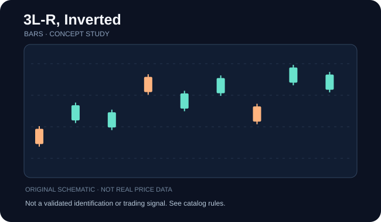

# 3L-R, Inverted

**Категория:** pattern · **Семейство:** [Краткие OHLC-паттерны](../references/bars.md) · **Уровень проверки:** `family_level`

## Схема / пример

**Иллюстрация:** самостоятельно сгенерированная схема семейства (НЕ скриншот, НЕ торговая история, НЕ верификация разновидности).

## Что означает

Правила нескольких соседних баров по диапазонам high/low/open/close.

**Особенности именно этой записи:** Инверсия означает зеркальную ориентацию эталонной геометрии; не путайте её с противоположным последующим пробоем. Для конкретного авторского short-pattern нужна явная формула по OHLC; категория не заменяет точное условие.

## Как проверить фигуру

Проверьте конкретную последовательность баров и предшествующий тренд; inside, outside, NR4 и NR7 различаются формальными условиями.

Проверка относится к **семейству**. Если доказана только принадлежность названия к классу, не считайте перечисленное точными уникальными правилами этой страницы источника. Чтобы формализовать детектор, нужны отдельные пороги, масштаб и примеры отрицательных случаев.

## Подтверждение / точка отсчёта

Триггер задавайте по максимуму/минимуму сигнального бара, закрытию и контексту.

**Статус:** до выполнения правил подтверждения помечайте объект как `unconfirmed`, после явного выполнения — `confirmed`, при нарушении исходного условия — `invalidated`, при нехватке данных — `indeterminate`.

## Опровержение и распространённые ошибки

Единичный бар без контекста может часто давать ложные совпадения.

Конкурирующая гипотеза: обычный участок шума, иной паттерн того же семейства или режим рынка без устойчивого сигнала. Проверяйте по закрытым барам, а не с учётом будущих свечей.

## Амплитуда и риск

Не использовать без точного алгоритма и без проверки на собственной выборке.

Оценивайте данные с поправкой на сплиты, дивиденды, гэпы и ликвидность; корректно разделяйте визуальную модель, торговые правила, доходность и оценку риска.

## Источник и ограничения

- [ThePatternSite — источник](https://www.thepatternsite.com/chartpatterns.html). Прямая страница конкретной записи НЕ проверена; приведён только общий каталог.
- [Общий алфавитный индекс](https://www.thepatternsite.com/chartpatterns.html).
- Эта страница содержит **самостоятельное методическое изложение**, не копию авторских текстов, таблиц, иллюстраций или исторических примеров.
- Статистические значения и коэффициенты не включены без отдельной верификации исходных условий.
