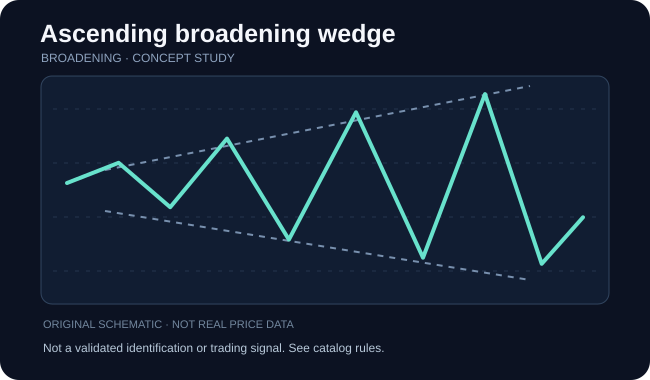

# Ascending broadening wedge

**Категория:** pattern · **Семейство:** [Расширяющиеся формации](../references/broadening.md) · **Уровень проверки:** `family_level`

## Схема / пример

**Иллюстрация:** самостоятельно сгенерированная схема семейства (НЕ скриншот, НЕ торговая история, НЕ верификация разновидности).

## Что означает

Волатильность увеличивается: максимумы и минимумы расходятся, вместо схождения образуя рупор.

**Особенности именно этой записи:** В названии обозначена бычья/восходящая ориентация; проверяйте направление фактического пробоя, а не предполагайте его.

## Как проверить фигуру

Ищите чередующиеся экстремумы и две расходящиеся границы; прямоугольные разновидности имеют одну почти горизонтальную сторону.

Проверка относится к **семейству**. Если доказана только принадлежность названия к классу, не считайте перечисленное точными уникальными правилами этой страницы источника. Чтобы формализовать детектор, нужны отдельные пороги, масштаб и примеры отрицательных случаев.

## Подтверждение / точка отсчёта

Необходим фактический выход за крайнюю границу; до этого устойчивое направление неизвестно.

**Статус:** до выполнения правил подтверждения помечайте объект как `unconfirmed`, после явного выполнения — `confirmed`, при нарушении исходного условия — `invalidated`, при нехватке данных — `indeterminate`.

## Опровержение и распространённые ошибки

Шум и одиночные шпильки могут имитировать расширение; низкая ликвидность и гэпы мешают идентификации.

Конкурирующая гипотеза: обычный участок шума, иной паттерн того же семейства или режим рынка без устойчивого сигнала. Проверяйте по закрытым барам, а не с учётом будущих свечей.

## Амплитуда и риск

Измерять диапазон и учитывать расширение волатильности при стопе.

Оценивайте данные с поправкой на сплиты, дивиденды, гэпы и ликвидность; корректно разделяйте визуальную модель, торговые правила, доходность и оценку риска.

## Источник и ограничения

- [ThePatternSite — источник](https://www.thepatternsite.com/chartpatterns.html). Прямая страница конкретной записи НЕ проверена; приведён только общий каталог.
- [Общий алфавитный индекс](https://www.thepatternsite.com/chartpatterns.html).
- Эта страница содержит **самостоятельное методическое изложение**, не копию авторских текстов, таблиц, иллюстраций или исторических примеров.
- Статистические значения и коэффициенты не включены без отдельной верификации исходных условий.
