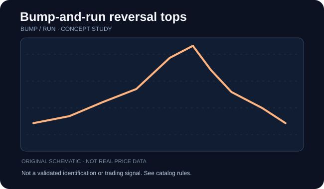

# Bump-and-run reversal tops

**Категория:** pattern · **Семейство:** [Bump-and-run reversal](../references/bump_run.md) · **Уровень проверки:** `family_level`

## Схема / пример

**Иллюстрация:** самостоятельно сгенерированная схема семейства (НЕ скриншот, НЕ торговая история, НЕ верификация разновидности).

## Что означает

Сначала умеренный тренд, затем ускоренный участок («bump») с чрезмерно крутым наклоном и последующим возвратом через исходную линию.

**Особенности именно этой записи:** В названии обозначена медвежья/нисходящая ориентация; фактическая динамика может её опровергнуть. Adam — узкие остроконечные экстремумы; Eve — относительно широкие округлые. Смешанные случаи бывают неоднозначны.

## Как проверить фигуру

Разделите базовую наклонную линию и фазу ускорения; важна смена угла, а не только один экстремум.

Проверка относится к **семейству**. Если доказана только принадлежность названия к классу, не считайте перечисленное точными уникальными правилами этой страницы источника. Чтобы формализовать детектор, нужны отдельные пороги, масштаб и примеры отрицательных случаев.

## Подтверждение / точка отсчёта

Слом исходной линии после ускорения и подтверждение контртрендовым ходом.

**Статус:** до выполнения правил подтверждения помечайте объект как `unconfirmed`, после явного выполнения — `confirmed`, при нарушении исходного условия — `invalidated`, при нехватке данных — `indeterminate`.

## Опровержение и распространённые ошибки

Весьма субъективный угол наклона и ошибки выбора точки начала.

Конкурирующая гипотеза: обычный участок шума, иной паттерн того же семейства или режим рынка без устойчивого сигнала. Проверяйте по закрытым барам, а не с учётом будущих свечей.

## Амплитуда и риск

Разметьте базовую линию, экстремум bump и цену фактического нарушения тренда.

Оценивайте данные с поправкой на сплиты, дивиденды, гэпы и ликвидность; корректно разделяйте визуальную модель, торговые правила, доходность и оценку риска.

## Источник и ограничения

- [ThePatternSite — источник](https://www.thepatternsite.com/chartpatterns.html). Прямая страница конкретной записи НЕ проверена; приведён только общий каталог.
- [Общий алфавитный индекс](https://www.thepatternsite.com/chartpatterns.html).
- Эта страница содержит **самостоятельное методическое изложение**, не копию авторских текстов, таблиц, иллюстраций или исторических примеров.
- Статистические значения и коэффициенты не включены без отдельной верификации исходных условий.
