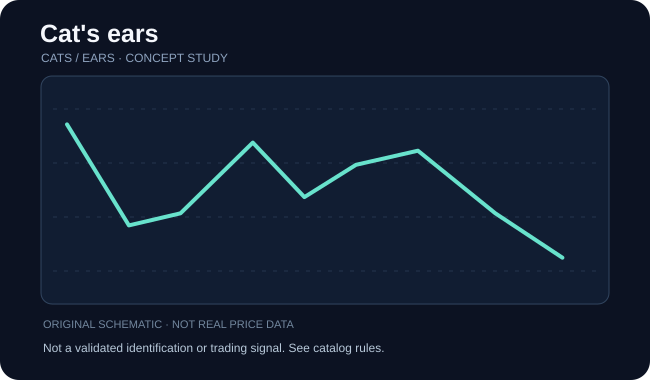

# Cat's ears

**Категория:** pattern · **Семейство:** [Кошачьи уши](../references/cats_ears.md) · **Уровень проверки:** `reference_verified`

## Схема / пример

**Иллюстрация:** самостоятельно сгенерированная схема семейства (НЕ скриншот, НЕ торговая история, НЕ верификация разновидности).

## Что означает

Медвежья комбинация двух вершин после падения: две локальные «ушные» вершины разделены областью «scalp».

**Особенности именно этой записи:** Вариант определяется спецификацией первоисточника; не подменять форму похожими фигурами.

## Как проверить фигуру

Проверьте нисходящий подход, паузу и два отчётливых пика; отдельно оцените 14-периодный RSI как вспомогательное условие оригинального описания.

Проверка относится к **семейству**. Если доказана только принадлежность названия к классу, не считайте перечисленное точными уникальными правилами этой страницы источника. Чтобы формализовать детектор, нужны отдельные пороги, масштаб и примеры отрицательных случаев.

## Подтверждение / точка отсчёта

Закрытие ниже разделяющего минимума; до пробоя не считать подтверждённой фигурой.

**Статус:** до выполнения правил подтверждения помечайте объект как `unconfirmed`, после явного выполнения — `confirmed`, при нарушении исходного условия — `invalidated`, при нехватке данных — `indeterminate`.

## Опровержение и распространённые ошибки

Автор сайта отдельно сообщает, что самостоятельно не тестировал результативность Cat’s Ears.

Конкурирующая гипотеза: обычный участок шума, иной паттерн того же семейства или режим рынка без устойчивого сигнала. Проверяйте по закрытым барам, а не с учётом будущих свечей.

## Амплитуда и риск

Измерение высоты между ухом и разделяющим минимумом — геометрический сценарий.

Оценивайте данные с поправкой на сплиты, дивиденды, гэпы и ликвидность; корректно разделяйте визуальную модель, торговые правила, доходность и оценку риска.

## Источник и ограничения

- [ThePatternSite — источник](https://www.thepatternsite.com/CatsEars.html). Проверенная прямая ссылка на конкретную страницу источника.
- [Общий алфавитный индекс](https://www.thepatternsite.com/chartpatterns.html).
- Эта страница содержит **самостоятельное методическое изложение**, не копию авторских текстов, таблиц, иллюстраций или исторических примеров.
- Статистические значения и коэффициенты не включены без отдельной верификации исходных условий.
