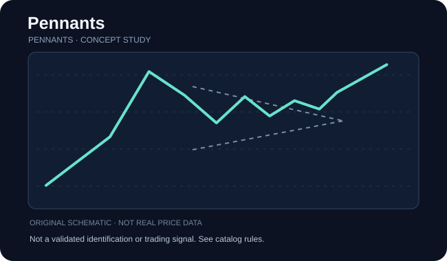

# Pennants

**Категория:** pattern · **Семейство:** [Вымпелы](../references/pennants.md) · **Уровень проверки:** `reference_verified`

## Схема / пример

**Иллюстрация:** самостоятельно сгенерированная схема семейства (НЕ скриншот, НЕ торговая история, НЕ верификация разновидности).

## Что означает

После резкого движения формируется маленький симметричный треугольник.

**Особенности именно этой записи:** Вариант определяется спецификацией первоисточника; не подменять форму похожими фигурами.

## Как проверить фигуру

Обязателен выраженный флагшток перед коротким сжатием; оцените время существования, а не только угол линий.

Проверка относится к **семейству**. Если доказана только принадлежность названия к классу, не считайте перечисленное точными уникальными правилами этой страницы источника. Чтобы формализовать детектор, нужны отдельные пороги, масштаб и примеры отрицательных случаев.

## Подтверждение / точка отсчёта

Подтверждающее закрытие за одной из сторон; продолжение тренда не гарантировано.

**Статус:** до выполнения правил подтверждения помечайте объект как `unconfirmed`, после явного выполнения — `confirmed`, при нарушении исходного условия — `invalidated`, при нехватке данных — `indeterminate`.

## Опровержение и распространённые ошибки

Форма без флагштока — скорее треугольник; поздний пробой может потерять смысл.

Конкурирующая гипотеза: обычный участок шума, иной паттерн того же семейства или режим рынка без устойчивого сигнала. Проверяйте по закрытым барам, а не с учётом будущих свечей.

## Амплитуда и риск

Сценарий может использовать часть длины флагштока, но проверяйте вероятность достижения отдельно.

Оценивайте данные с поправкой на сплиты, дивиденды, гэпы и ликвидность; корректно разделяйте визуальную модель, торговые правила, доходность и оценку риска.

## Источник и ограничения

- [ThePatternSite — источник](https://www.thepatternsite.com/pennants.html). Проверенная прямая ссылка на конкретную страницу источника.
- [Общий алфавитный индекс](https://www.thepatternsite.com/chartpatterns.html).
- Эта страница содержит **самостоятельное методическое изложение**, не копию авторских текстов, таблиц, иллюстраций или исторических примеров.
- Статистические значения и коэффициенты не включены без отдельной верификации исходных условий.
