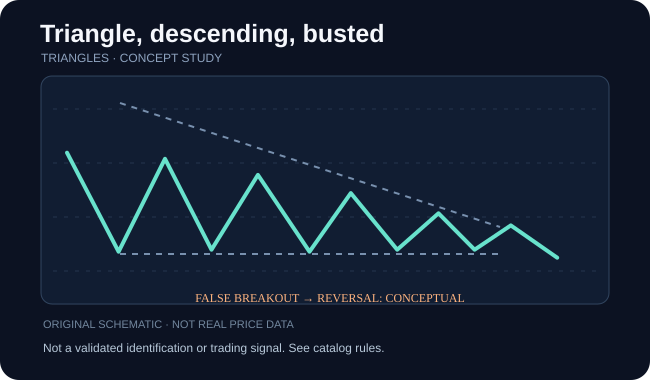

# Triangle, descending, busted

**Категория:** pattern · **Семейство:** [Треугольники](../references/triangles.md) · **Уровень проверки:** `family_level`

## Схема / пример

**Иллюстрация:** самостоятельно сгенерированная схема семейства (НЕ скриншот, НЕ торговая история, НЕ верификация разновидности).

## Что означает

Сжатие диапазона между двумя границами: горизонтальная и наклонная либо две сходящиеся.

**Особенности именно этой записи:** В названии обозначена медвежья/нисходящая ориентация; фактическая динамика может её опровергнуть. Busted — первоначальный пробой оказался неустойчивым, затем цена пересекла противоположный уровень; нужен контроль двух последовательных событий.

## Как проверить фигуру

Отмечайте последовательные экстремумы, проводите верхнюю/нижнюю границы только по сформированным точкам. Для восходящего варианта верх близок к горизонтали, для нисходящего горизонтален низ; симметричный сходится с двух сторон.

Проверка относится к **семейству**. Если доказана только принадлежность названия к классу, не считайте перечисленное точными уникальными правилами этой страницы источника. Чтобы формализовать детектор, нужны отдельные пороги, масштаб и примеры отрицательных случаев.

## Подтверждение / точка отсчёта

Закрытие вне границы после достаточного числа касаний — кандидат на пробой; направление нельзя надёжно вывести из названия.

**Статус:** до выполнения правил подтверждения помечайте объект как `unconfirmed`, после явного выполнения — `confirmed`, при нарушении исходного условия — `invalidated`, при нехватке данных — `indeterminate`.

## Опровержение и распространённые ошибки

Возврат внутрь границ, ложный выход перед апексом, слишком мало независимых касаний.

Конкурирующая гипотеза: обычный участок шума, иной паттерн того же семейства или режим рынка без устойчивого сигнала. Проверяйте по закрытым барам, а не с учётом будущих свечей.

## Амплитуда и риск

Для целей иногда используют высоту основания, отложенную от пробоя; это сценарий, не обещание.

Оценивайте данные с поправкой на сплиты, дивиденды, гэпы и ликвидность; корректно разделяйте визуальную модель, торговые правила, доходность и оценку риска.

## Источник и ограничения

- [ThePatternSite — источник](https://www.thepatternsite.com/chartpatterns.html). Прямая страница конкретной записи НЕ проверена; приведён только общий каталог.
- [Общий алфавитный индекс](https://www.thepatternsite.com/chartpatterns.html).
- Эта страница содержит **самостоятельное методическое изложение**, не копию авторских текстов, таблиц, иллюстраций или исторических примеров.
- Статистические значения и коэффициенты не включены без отдельной верификации исходных условий.
